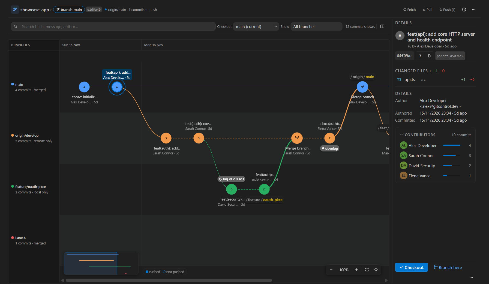
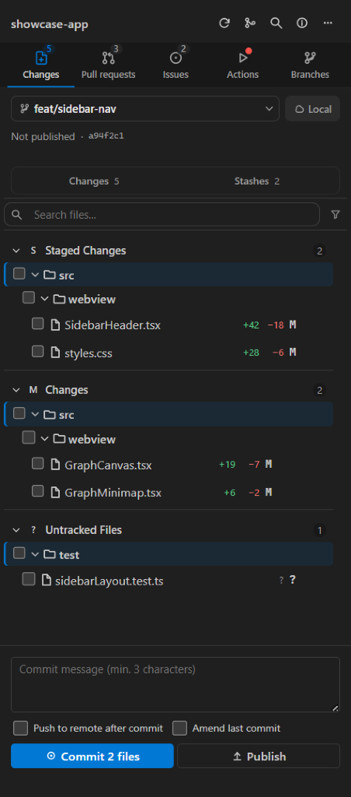
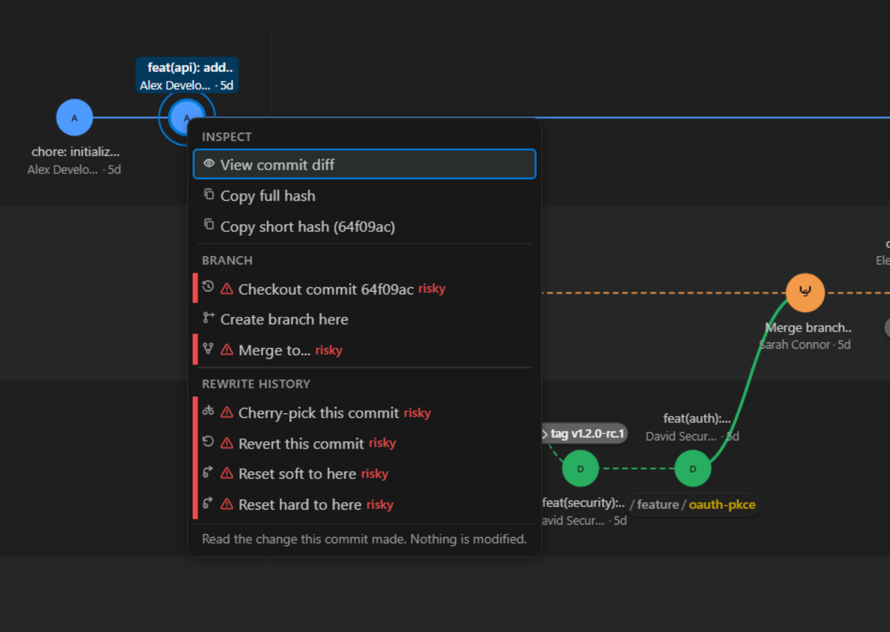
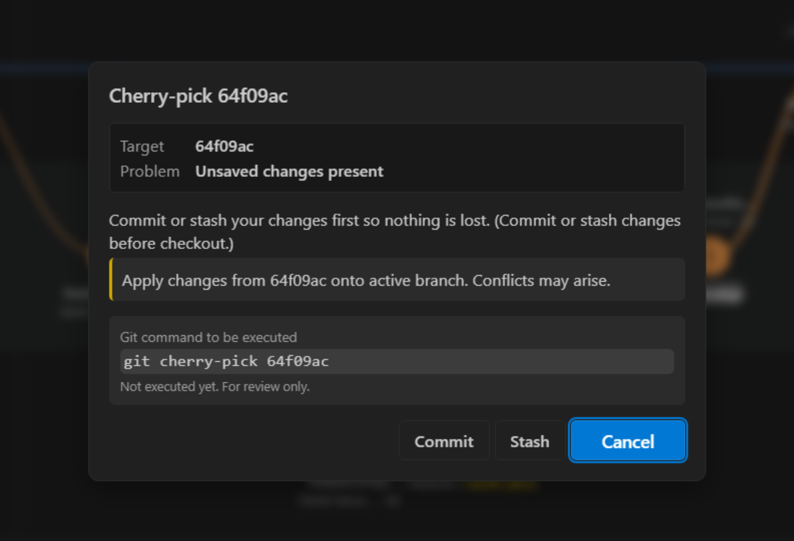
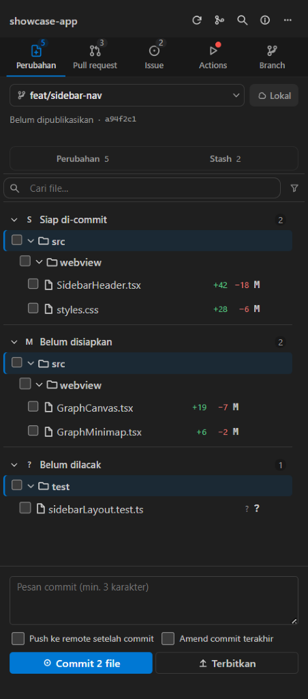

# Git Control

Git Control is an interactive 2D Git DAG graph explorer and source control manager for Visual Studio Code, featuring a unified **Git Control** sidebar shell for pending changes, pull requests, issues, workflow runs, and branches.

Navigate commit histories visually, inspect branches and merge lanes, stage changes granularly, and run standard Git and GitHub operations directly from a unified interface without relying on terminal commands.

## Overview

Git Control replaces flat vertical commit lists with an interactive two-dimensional Directed Acyclic Graph (DAG) paired with the **Git Control** sidebar view, a routed shell with a persistent 5-tab navigation strip (Changes, Pull requests, Issues, Actions, and Branches). The interface is designed for fast navigation, clear visual context, and data safety.

## Key Features

### 1. Interactive 2D Branch Explorer
* **Topological DAG Canvas**: Visualizes branches, merges, tags, HEAD position, and remote synchronization status with deterministic lane allocation.
* **Branches Lane Column**: Fixed column beside the canvas that names every lane with its commit count and status (`merged`, `remote only`, `local only`, `tag`, or upstream tracking target) aligned at any zoom and scroll.
* **Navigation and Filtering**: Pan, zoom (35% to 400%), search by commit message, hash, or author, and isolate specific branches.
* **Canvas Minimap**: Compact overview map for large repositories.
* **High-Capacity History**: Loads up to 10,000 commits per view with on-demand pagination for older history.

### 2. Contributors Leaderboard Panel
* **Ranked Contribution Leaderboard**: Ranks contributors by commit count using `git shortlog` with proportional visual bars scaled to the top contributor.
* **Collapsible Sidebar Panel**: Positioned directly beneath the Inspector in the Explorer sidebar, displaying total repository commits with an expandable toggle for rosters beyond the top 10.
* **GitHub Profile Navigation**: Clicking an author opens their GitHub profile when verified, or highlights their entry in the leaderboard.
* **Adaptive Avatar Rendering**: Displays GitHub profile avatars via the GitHub API, with automatic fallback to deterministic color-coded initials when offline or unlinked.

### 3. Git Control Sidebar and Pending Changes

* **Persistent Sidebar Navigation**: Five tabs (Changes, Pull requests, Issues, Actions, and Branches) with count badges on Changes, Pull requests, and Issues, and a red failing dot on Actions when the latest run on the current branch failed.
* **Sidebar Header**: Repository title row with Refresh, Open Explorer graph, Quick actions search, Help info, and More menu; branch selector with ahead/behind sync chip; and upstream tracking row showing the tracking branch and active commit hash. Other tabs use a compact single-row header with route-specific create actions.
* **Pinned Commit Footer and Amend**: Commit message box, "Amend last commit" toggle (loads the last commit message when the box is empty and blocks amending when HEAD is already on the upstream branch because pushing would require a force push), "Push to remote after commit", and Commit, Push or Publish, and Pull actions pinned at the bottom of the panel.
* **Granular Staging**: Tree and list views for Staged, Unstaged, Untracked, and Conflicted files with batch or individual file selection.
* **Recursive Folder Selection**: Checking a folder toggles all child files automatically.
* **Inline File Churn**: Displays added and deleted line counts alongside binary and untracked indicators.
* **File Icon Theme Integration**: File rows display icons from the active VS Code File Icon Theme, updating automatically on theme changes.
* **Pull from Upstream**: Pull active branch from its upstream with dirty working tree guard offering commit, stash, and cancel remedies.
* **Per-File Discard**: Discard unstaged changes for individual files with two-step destructive confirmation, blocked during active operations and conflicts.
* **Dense SCM Layout**: Change rows, section headers, and the commit card follow the VS Code Source Control density, keeping the sidebar readable and nearly full width, with the active-row wash flush to both edges and only the row content inset.
* **Changes and Stashes Tabs**: A segmented control above the list switches between the change list and the stash list, each with its count. The open tab is remembered when the sidebar is hidden and shown again.

### 4. Stash Management
* **List, Apply, and Drop Stashes**: List all stashes with apply (keeps the entry) and drop actions; drop requires two-step destructive confirmation.
* **Stash Filter**: Search stashes by number or hash in the Stashes tab. Filtering never renumbers a stash, so Apply and Drop act on the stash shown.
* **Expandable Stash Entries**: Expand stash entries to view file contents with file icons, line churn counters, and click-to-diff.
* **Commit Hash Navigation**: "Stash N from <hash>" labels; clicking the hash opens the Branch Explorer and selects that commit.

### 5. Node Context Menu and Branch Operations
Right-click any commit node or branch ref to perform standard Git actions:

* **Checkout**: Switch branches or checkout specific commits into detached HEAD state.
* **Branch Management**: Create new branches pointing directly to selected commits.
* **Merge Workflows**: Merge target branches into the active branch with visual status tracking.
* **Revert**: Generate standard inverse commits while preserving branch history.
* **Reset**: Choose between Soft Reset (moves HEAD, keeps working changes staged) and Hard Reset.
* **Cherry-Pick**: Apply a single commit from the node context menu with full conflict flow support (continue and abort actions available during cherry-pick, conflicted files surface in resolution panel).
* **Push Up To**: Fast-forward push repository history up to a selected commit hash.

### 6. Safety Guard and Conflict Resolution

* **Dirty-Tree Protection**: Prevents accidental checkouts, resets, or merges when unstaged or uncommitted changes are present.
* **Two-Stage Destructive Confirmation**: Explicit dual-stage review required before executing irreversible actions like Hard Reset.
* **Remote-Ahead Detection**: Warns when the remote branch contains incoming commits, preventing unintentional non-fast-forward push rejections.
* **Dedicated Conflict Panel**: Lists conflicted files during merge, rebase, or cherry-pick states with quick shortcuts to the VS Code merge editor.

### 7. Commit Inspector and Diff Viewer
* **Detailed Commit Metadata**: Displays author, committer, commit date, hash, and parent commits.
* **Multi-Parent Comparison**: Compare merge commits against any individual parent commit.
* **Integrated Diffing**: Opens files directly in the native VS Code Diff Editor.
* **File Changes Breakdown**: Summarizes changed files and line modifications, including binary file identification.
* **Author Avatar**: Shows the commit author's GitHub avatar in the inspector header, falling back to deterministic initials when the author is unlinked or offline.

### 8. GitHub Integration
* **Token Storage**: Connects directly to GitHub via VS Code SecretStorage without exposing credentials.
* **Pull Request Visibility**: Displays pull request statuses and numbers associated with branch heads.
* **Checks at a Glance**: Each pull request row carries a check badge, loaded only for the rows scrolled into view. A failing row names the checks that broke.
* **Commit to Pull Request**: The commit inspector shows the pull request that contains the selected commit, with its state, base branch, and check summary, or says the commit is not part of one.
* **Create Pull Request**: Open the dialog from the Pull requests view, review the generated title and body, and preview the push and the API call before submitting. A branch that is not on the remote is published first.
* **Checkout Pull Request**: The branch button on a row fetches the pull request head into a local branch named `pr/<number>` and switches to it. Unsaved changes are handled with the usual commit or stash options. Checking out again fast-forwards the branch, and a branch with local commits the pull request does not have is refused rather than overwritten.
* **Pull Request Detail Panel**: Opens one dedicated editor tab per pull request number with Conversation, Commits, Checks, and Files changed tabs, inline diff launch against the merge base, and a reviewers and labels rail.
* **Merge, Review, and Close Pull Requests**: Merge commit or Squash and merge directly from the panel after confirming the target branches, optional branch deletion (disabled on fork PRs, with default-branch protection), and exact commands; submit reviews (Approve, Request changes, or Comment) pinned to the head SHA; reply inline inside review threads; and close a pull request from the More menu behind a Level 1 confirmation dialog.
* **Issues and Issue Write Actions**: Browse assigned, created, and mentioned issues, start a local branch from an issue, post comments inline from the expanded issue row, close an issue as completed with an Undo toast action, reopen closed issues, and create new issues with a title, description, and existing repository labels.
* **Actions Write Actions**: Re-run failed jobs on completed failing runs directly from expanded run rows, or dispatch a workflow on any branch through the Run workflow dialog with parsed input fields, command preview, burst polling, and an Open on GitHub fallback when workflow inputs cannot be parsed.
* **Tags and Releases**: Create annotated or lightweight tags from the Branches view with advisory semver suggestions, push one tag using an explicit `refs/tags/` refspec without force semantics, and optionally publish a GitHub release (without asset upload) with notes generated by GitHub and a live step progress preview.
* **External Navigation**: Direct links to view commits and pull requests in the browser.
* **Rate Limit Monitoring**: Real-time indicator for GitHub REST API quotas and cache status.
* **Contributor Identity Resolution**: Resolves author email addresses to GitHub profiles and avatars with cached API queries.

### 9. Help Panel

* **Feature Guide**: One plain sentence per shipped view, grouped into Everyday, With GitHub, and Organize, each row opening the view it describes.
* **Verified Shortcut List**: Every key listed is tied to the handler that implements it by a test, so a key that disappears from the code cannot stay in the panel.
* **Checklist Return**: The footer brings the Get started checklist back after it was dismissed.
* **Reachable Everywhere**: Open it from the info button in the sidebar header or from `Git Control: Help and Shortcuts`.

### 10. Explorer Header

* **Sync Buttons**: Fetch, Pull, and Publish or Push sit beside the breadcrumbs with ahead and behind counts, running the same actions and guard flow as the sidebar footer. The group is hidden when the repository has no remote.
* **Help Button**: Opens the Help panel in the sidebar, revealing the sidebar when it was never opened in this session.
* **More Menu**: Quick actions, every sidebar view, Refresh graph, Show Git output, GitHub connect or disconnect, and Pick repository, with the Changes and Pull requests counts.
* **One Header In Every State**: Both buttons render while the repository is still loading, and the menu never runs a git mutation.

### 11. Bilingual Interface

Git Control ships a complete English and Bahasa Indonesia UI, switched from the status bar toggle or the `gitControl.language` setting. Panel chrome, section headers, buttons, tooltips, and accessible names are all translated, and the selection controls keep identical widths in both languages.

### 12. Branches, Tags, Compare, and Worktrees

* **Local, Remote, and Tags Sub-Tabs**: Browse and filter local branches, remote branches, and tags with `merged`, `local only`, and `upstream gone` chips, sorted by recent activity, name, or ahead and behind counts.
* **Clean Up Merged Branches**: Batch-delete merged local branches safely (`git branch -d`, surfacing git's own refusal on unmerged work) with an optional step to delete matching remote branches after explicit confirmation.
* **Compare Refs**: Compare any two branches, tags, or commits inside the Branches view with ahead and behind counts, head-side commits (click to reveal in the graph), changed files with line counts (click to open a merge-base-to-head VS Code diff), and swap sides.
* **Worktrees**: View active worktrees and add a linked worktree for any local branch (`Add worktree...`) with a host folder picker, `git worktree add -- <path> <branch>` command preview, and a post-add `Open folder` action.

### 13. Quick Actions Palette

* **Fast Navigation and Focus**: Open from `Ctrl + K G` (`Cmd + K G` on macOS), the sidebar header search icon, the Explorer More menu, or `Git Control: Quick Actions` in the Command Palette.
* **Branch-Aware Suggestions**: Ranks up to three next-step suggestions for the current branch state alongside Go-to rows for every sidebar view and Help rows.
* **Non-Mutating**: Selecting a row navigates to the target view and focuses its control without executing git or GitHub mutations.

### 14. Get Started Checklist

* **Four-Step Onboarding Card**: Guides repository setup in the `Changes` view (`Connect GitHub`, `Save changes with a commit`, `Publish your branch`, and `Open a pull request`), derived from live repository and GitHub state with inapplicable steps hidden.
* **Dismissible and Reopenable**: Dismissible per workspace, hides automatically after completion, reachable from Quick actions, and reopenable from the Help panel footer.

## Requirements

* **Visual Studio Code**: Version 1.90.0 or higher.
* **Git CLI**: Git installed and accessible via system `PATH`, or explicitly defined in extension settings.

## Getting Started

1. Open any workspace folder containing a Git repository in Visual Studio Code.
2. Click the **Git Control** icon in the Activity Bar to open the **Git Control** sidebar view, and switch between Changes, Pull requests, Issues, Actions, and Branches using the persistent 5-tab navigation strip.
3. Open the **Branch Explorer** graph using the graph icon in the sidebar header, the graph icon on the Source Control panel title bar, or Command Palette (`Git Control: Open Explorer`).
4. Follow the **Get started** checklist in `Changes`, stage changes, commit or amend local commits, and execute branch or GitHub operations directly through the interface.
5. Use Quick actions (`Ctrl + K G` / `Cmd + K G` on macOS, or the search icon in the sidebar header), the Help button, or the More menu to open any sidebar view, view shortcuts, or switch repositories without leaving your workflow.

## Extension Settings

Git Control contributes the following settings under `gitControl.*`:

| Setting | Type | Default | Description | Scope |
|---|---|---|---|---|
| `gitControl.gitPath` | string | `""` | Absolute path to the Git executable. When left empty, uses `git` from system PATH. | Machine |
| `gitControl.commitLimit` | number | `10000` | Maximum number of commits loaded into the graph canvas (100 to 10000). | Window |
| `gitControl.pageSize` | number | `500` | Number of commits retrieved per page during historical data fetch. | Window |
| `gitControl.showIgnoredFiles` | boolean | `false` | When enabled, shows gitignored files in the Pending Changes panel. | Window |
| `gitControl.githubApiUrl` | string | `https://api.github.com` | Base URL for GitHub API requests. Customize when connecting to GitHub Enterprise. | Machine |
| `gitControl.fetchStalenessMs` | number | `300000` | Milliseconds after which cached remote status is treated as stale (default: 5 minutes). | Window |
| `gitControl.language` | string (`en` \| `id`) | `en` | Interface display language (`en` for English, `id` for Bahasa Indonesia). | Window |

## Available Commands

Access these commands through the Command Palette (`Ctrl+Shift+P` / `Cmd+Shift+P`):

* `Git Control: Open Explorer`: Opens the interactive 2D Branch Explorer canvas.
* `Git Control: Open Pending Changes`: Focuses the Pending Changes panel in the sidebar.
* `Git Control: Quick Actions`: Opens a palette of suggested next steps for the current branch plus a shortcut to every sidebar view. Rows navigate and focus a control; nothing runs until you press the button.
* `Git Control: Help and Shortcuts`: Opens the Help panel, which explains every sidebar view and lists the keyboard shortcuts that drive the graph, the change list, and the menus.
* `Git Control: Refresh`: Forces an immediate re-fetch and re-render of repository state and history.
* `Git Control: Pick Repository`: Switches active repository focus in multi-root workspaces.
* `Git Control: Connect GitHub`: Securely stores a Personal Access Token to fetch PR details and remote stats.
* `Git Control: Disconnect GitHub`: Clears stored authentication tokens and removes GitHub API linkage.
* `Git Control: Show Logs`: Opens the Git Control output channel to inspect Git execution and diagnostic logs.

## Token Scopes

Git Control uses a Personal Access Token stored in VS Code `SecretStorage`. Reads and writes need different permissions, and a token that can read may not be allowed to change anything.

| Capability | Classic PAT scope | Fine-grained token permission |
|---|---|---|
| Read pull requests, issues, workflow runs, job logs | `repo` for private repositories, none for public | Pull requests: Read. Actions: Read. Contents: Read |
| Read the private-repository warning state | `repo:status` | Metadata: Read |
| Create, comment on, merge, close, or reopen pull requests and issues | `repo` | Pull requests: Read and write. Issues: Read and write |
| Re-run failed jobs and dispatch a workflow | `repo` and `workflow` | Actions: Read and write (plus Contents: Read to read workflow inputs) |
| Generate release notes and create releases through the API | `repo` | Contents: Read and write |

Behavior that applies to both token types:

* A write is refused before anything is sent when the connection is missing, the API base came from a repository remote rather than your settings, the circuit breaker is open, or the granted scopes are known to lack `repo`.
* Fine-grained tokens do not report their scopes, so Git Control cannot check them ahead of time. The write is attempted and a `403` from GitHub is reported as a permission problem instead.
* Writes are never retried automatically. A repeated `POST` would create a second pull request, comment, or release, so a failed write is yours to retry.
* Creating a pull request from a branch that is not on the remote publishes that branch with upstream tracking first. Nothing is ever force-pushed.
* A pull request that already exists for the same branch pair is reported with its number instead of creating a second one.
* A pull request from a fork is checked out for reading only. The row is marked read only, and a push from its `pr/<number>` branch is refused by the host before any git process starts. The same refusal covers publishing that branch from the create pull request dialog, and the mark is cleared by a later checkout of a same-repository pull request with the same number.
* Checking out a pull request runs the repository's own `post-checkout` hook, not a hook from the fork. Review the hook in `.git/hooks` before checking out code you do not trust.

**After changing a token's scopes**, reconnect so the new permissions are read:

1. Run `Git Control: Disconnect GitHub`.
2. Run `Git Control: Connect GitHub` and paste the token again.
3. Reload the window if the Pull requests view still shows the old permission state.

## Security Architecture

* **Zero Shell Interpolation**: All Git commands execute via direct process spawning without shell evaluation, preventing command injection vulnerabilities.
* **Token Isolation**: GitHub authentication tokens are stored strictly within VS Code `SecretStorage` and are never serialized to configuration files, state logs, or webview message bridges.
* **Strict Remote Trust Boundary**: Remote endpoints are validated before dispatching authenticated requests, preventing credential leaks to arbitrary hosts.
* **Non-Destructive Defaults**: Force-push operations (such as force push) are intentionally omitted to maintain repository integrity.

## Keyboard Shortcuts

Click the graph, minimap, or changes list once to focus it before using its shortcuts.

### Anywhere

| Key | Action |
|---|---|
| `Ctrl + K G` (`Cmd + K G` on macOS) | Open Quick actions from the editor, the sidebar, or the Explorer panel |

The Quick actions chord is unscoped because a sidebar webview does not set `focusedView` or `sideBarFocus`, so a scoped clause could never fire there. It has no default binding in VS Code.

### Graph Explorer

| Key | Action |
|---|---|
| `Left` / `Right` | Move to the previous or next commit |
| `Up` / `Down` | Move to the nearest commit in the lane above or below (or pan vertically if none) |
| `PageUp` / `PageDown` | Jump one screen backward or forward |
| `Home` / `End` | Jump to the first or last loaded commit |
| `Enter` or `Space` | Open commit details in the Inspector |
| `+` / `-` / `0` | Zoom in, zoom out, or reset zoom to 100% |
| `Menu` or `Shift F10` | Open the context menu for the selected commit |
| `Ctrl + Scroll` (`Cmd + Scroll` on macOS) | Zoom in or out with the mouse wheel |
| `Space + Drag` | Pan the canvas anywhere, including over commit rows and nodes |
| `Left` / `Right` / `PageUp` / `PageDown` / `Home` / `End` | Scroll the minimap horizontally when focused |

### Changes List

| Key | Action |
|---|---|
| `Up` / `Down` | Move between file and folder rows |
| `Right` / `Left` | Open or close a folder, or move to its first child or parent row |
| `Home` / `End` | Jump to the first or last row |
| `Enter` | Open diff for the selected file, or toggle a folder |

### Menus and Dialogs

| Key | Action |
|---|---|
| `Esc` | Close the open context menu, dialog, or branch legend |
| `Up` / `Down` | Move between items in a context menu |
| `Home` / `End` | Jump to the first or last item in a context menu |
| `Tab` | Cycle focus inside an open dialog (`Shift + Tab` moves backward) |

## License

This project is licensed under the MIT License. See the [LICENSE](LICENSE) file for details.
